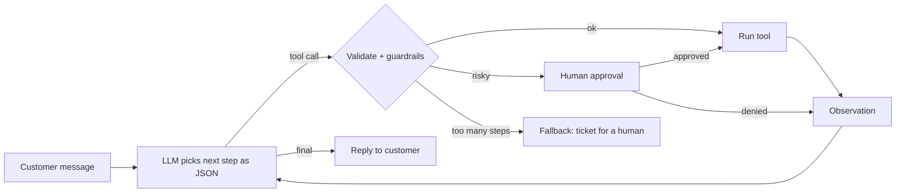

# Support Agent

An AI support agent that **takes actions**, not just answers questions. It decides which tool to call
(docs search, order lookup, refund check, ticket creation), runs it, reads the result, and repeats until it can
reply to the customer. Risky actions need human approval, and policy decisions are enforced in code.

Builds on [support-docs-rag](https://github.com/YOUR-USERNAME/support-docs-rag): the agent calls that
project's `/query` endpoint as its `search_docs` tool.



## Tools
| Tool | What it does | Risky |
|---|---|---|
| `search_docs` | Asks the RAG service about policies | no |
| `lookup_order` | Reads an order from a mock database | no |
| `check_refund_eligibility` | Applies the 14-day policy **in code** | no |
| `issue_refund` | Records a refund; re-checks the policy even after approval | **yes** |
| `create_ticket` | Hands the case to a human | no |

## Guardrails
- Max steps per task; on overflow a ticket is created automatically
- Strict JSON protocol; malformed replies get an error message and a retry
- Unknown tools, missing arguments and repeated identical calls are rejected
- `issue_refund` is denied unless a human approves, and the policy is re-checked in code anyway
- A crashing tool returns an error to the model instead of crashing the agent
- Every step is written to `traces/*.jsonl`

## Run it
```powershell
# Terminal 1: the RAG service from project 1 (its folder, venv active)
uvicorn app.main:app

# Terminal 2: this project
python -m venv .venv
.venv\Scripts\Activate.ps1
pip install -r requirements.txt
copy .env.example .env
pytest                                   # 19 tests, no AI model needed

python -m agent.cli "How do I reset my password?"
python -m agent.cli "I bought order #1042 three weeks ago and want a refund."
python -m agent.cli "Please refund order 1043, I bought it 5 days ago."
```

## Design notes
- The model never does arithmetic or policy: eligibility is deterministic code.
- The loop uses a plain JSON protocol instead of provider-specific tool-calling APIs, so any model works.
- The model is injected as a function, so tests use a scripted fake model and need no AI.

## Roadmap
- [ ] Benchmark of 25 scenarios with success rate per model
- [ ] Compare `llama3.2:3b` with a larger model
- [ ] Web UI that shows the trace
